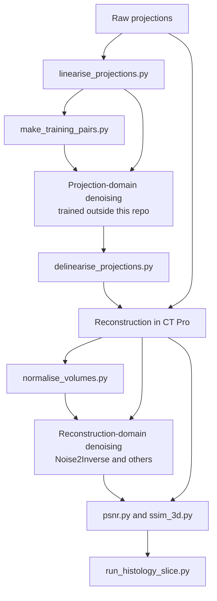

# MSc-Project---Evaluation-of-ML-Denoising-Strategies-for-Accelerated-3D-X-ray-Histology-Imaging
This study aimed to quantitatively assess the performance of a variety of deep learning model methods on micro-CT scans which were scanned more quickly than the optimal and standard scanning standards using CNN models, comparing to baseline filtering techqiues

Code for my MSc Biomedical Engineering dissertation (University of Southampton, 2025–26).

Micro-CT can image whole formalin-fixed, paraffin-embedded (FFPE) tissue blocks in 3D without sectioning, but high-quality scans need long exposures. This project asks how much of that quality can be recovered from short-exposure, noisy scans using denoising. A lung FFPE sample was scanned at four exposure times, and every denoising method is scored against a long-exposure reference scan of the same sample.

The repository contains the data-preparation, training, evaluation and histology-comparison scripts. It covers:

- **Noise2Inverse** self-supervised denoising of reconstructed volumes (trained here).
- **Conversion tools** that move projections between raw transmission and linear attenuation space, so denoising can be done in the projection domain.
- **Evaluation** of every method against the reference with whole-image PSNR and 3D SSIM.
- **Histology-plane reslicing**, so a slice from any volume can be compared with a conventional histology section.
- Note: Other U-Net models were applied through the software **Dragonfly** for comparison

## Data

| | |
|---|---|
| Sample | FFPE lung tissue block, containing small, very bright calcifications |
| Exposures | 67 ms, 89 ms, 177 ms, 354 ms (2002 projections each) |
| Reference | 354 ms "Optimal" scan: 4-frame averaged, 3502 projections |
| Volume size | 2025 × 1544 × 2499 voxels (X × Y × Z), float32, about 29 GiB per volume |
| Voxel size | 16.4 µm (isotropic) |
| Scanner software | Nikon CT Pro (reconstruction) |

The scan data is not included in this repository.

## Pipeline



## Scripts

| Script | What it does |
|---|---|
| `train_and_denoise_noise2inverse_67ms_with_ES_huber.py` | Trains a Noise2Inverse U-Net on K = 4 sub-reconstructions of the 67 ms scan, then denoises the volume and writes it as `.vol` (+ `.vgi` header) or per-slice TIFFs. |
| `linearise_projections.py` | Flat-field corrects raw projections and applies `-log(I)` to put them in linear attenuation space. |
| `delinearise_projections.py` | Exact inverse of the above, so denoised projections can be reconstructed by CT Pro, which applies its own flat-field and log steps. |
| `make_training_pairs.py` | Builds 100 clean/noisy projection pairs matched by rotation angle, for the supervised projection-domain models. |
| `normalise_volumes.py` | Streams a large `.raw` volume to `[0, 1]` for Dragonfly and converts the output back to the original intensity range. |
| `volume_registry.py` | Single place that records volume geometry and the path of every raw scan and denoised output, so each can be selected by a short name such as `n2v-proj-89ms`. |
| `psnr.py` | Whole-image PSNR of every registered volume against the reference. |
| `ssim_3d.py` | 3D SSIM over the cropped tissue region, appended to an Excel file. |
| `histreslice_pipeline.py` | Reorients a volume so a slice matches the plane of a histology section (Python translation of the facility's HistRelevantReslice ImageJ macro). |
| `run_histology_slice.py` | Runs the reslice pipeline with the angles and crop boxes for this sample and saves one slice as a TIFF. |

## Methods compared

Every method is applied to all four exposures and compared with the 354 ms Optimal reference (see `volume_registry.py`).

| Key | Method | Domain |
|---|---|---|
| `medgaus` | Median + Gaussian filtering (classical baseline) | Reconstruction |
| `generic` | Generic denoising model | Reconstruction |
| `n2v-recon` | Noise2Void | Reconstruction |
| `n2v-proj` | Noise2Void | Projections |
| `100pairclean-huber` | Supervised U-Net, 100 clean/noisy pairs, Huber loss | Projections |
| `100pairclean-mixedgrad` | Supervised U-Net, 100 pairs, mixed-gradient loss | Projections |
| `unetpp-huber` | Supervised U-Net++, Huber loss | Projections |
| Noise2Inverse | Self-supervised U-Net, X:1 strategy (this repo) | Reconstruction |

Only Noise2Inverse is trained by code in this repository. The other models were trained 
through the software Dragonfly, and this repo holds the surrounding data preparation, conversion and evaluation. Noise2Inverse is not yet registered in `volume_registry.py`; add its output path to `METHOD_TEMPLATES` or `PATH_OVERRIDES` to include it in the PSNR and SSIM runs. Noise2Inverse is added for future work rather than for comparison in this paper.

## Requirements

The default settings were developed on a machine with a 20 GB GPU and a 24-thread CPU. Volumes are read with memory-mapping or one slice at a time, so RAM use stays low, but fast disk access matters.

### 1. Linearise projections

```bash
# No flat image available: estimate the open beam from a background-only strip
python linearise_projections.py --proj_dir ./projections --estimate_flat_roi 0 0 2027 50 --out_dir ./projections_linear

# Or use a scalar white level from the scanner's .xtekct file
python linearise_projections.py --proj_dir ./projections --white_level 60000 --out_dir ./projections_linear
```

### 2. Build training pairs

```bash
python make_training_pairs.py
```

Reference and noisy projections are matched by angle, not by index. Taking every 35th reference projection (of 3502) and every 20th noisy projection (of 2002) gives 100 pairs, one every 3.6°.

### 3. Convert denoised projections back for reconstruction

```bash
python delinearise_projections.py --lin_dir ./denoised_linear --white_level 60000 --out_dir ./denoised_raw
```

Use the same flat, dark or white level as in step 1, otherwise the intensity scale will not match the original scan.

### 4. Normalise and de-normalise volumes

```bash
python normalise_volumes.py normalise   --input scan.raw --output scan_norm.raw
python normalise_volumes.py denormalise --input denoised_norm.raw --output denoised.raw --ranges scan_norm_range.json
```

The intensity range is measured from a middle band of slices only, so air and reconstruction artefacts at the ends do not compress the tissue into a narrow part of the range. The range is saved to JSON and reused when de-normalising.

### 5. Train and apply Noise2Inverse

Edit the `CONFIG` block of `train_and_denoise_noise2inverse.py` (paths to the K subset volumes, `VOL_SHAPE`, `DATA_MIN`, `DATA_MAX`), then run:

```bash
python train_and_denoise_noise2inverse_67ms_with_ES_huber.py
```

Key settings:

| Setting | Value |
|---|---|
| Strategy | X:1 with K = 4 (input = mean of 3 sub-reconstructions, target = the held-out one) |
| Network | U-Net (DnCNN available via `NETWORK`) |
| Loss | Huber, δ = 0.05 (the original paper uses MSE) |
| Optimiser | Adam, learning rate 1e-3 |
| Patches | Random 512 × 512 crops for training, fixed centre crop for validation |
| Batch size | 12 |
| Epochs | Up to 50, early stopping with patience 15 |
| Validation | Last 20% of Z-slices, never seen in training; best-validation weights are kept |
| Normalisation | Values clipped to `[DATA_MIN, DATA_MAX]` then scaled to `[0, 1]` |
| Inference | `"paper"`: average the network output over the K held-out inputs (Noise2Inverse Eq. 20); `"full"`: feed the full reconstruction |

Two design choices are worth knowing about:

- **Huber loss.** The sample contains a few very bright calcifications that dominate plain MSE. Huber behaves like MSE for small errors and like L1 for large ones, so these voxels have less influence.
- **`DATA_MAX` is not the true maximum.** It is set near the 99.9th percentile of the volume. Using the calcification maximum squashes the tissue into the bottom few percent of `[0, 1]` and produced dark halos around bright voxels. Calcifications simply clip to 1.0.

Inference in `"full"` mode showed about 20% contrast shrinkage on bright features (the input differs from what the network saw in training), so `"paper"` mode is the default.

### 6. Evaluate

```bash
python psnr.py --preview     # sanity-check axis and byte order first
python psnr.py               # writes psnr_per_slice.csv and psnr_summary.csv

python ssim_3d.py 354ms-Optimal 67ms          # one comparison
python ssim_3d.py 354ms-Optimal denoised      # every denoised output
python ssim_3d.py 354ms-Optimal n2v-proj      # one method, all exposures
```

- **PSNR** compares every 10th slice (Z = 650–1415, 77 slices) with the reference. `MAX_I` is measured from the intensity range *outside* the specimen, because including the calcifications would inflate it, and PSNR, for every method.
- **SSIM** is 3D, with a 7 × 7 × 7 window, computed only inside a bounding box around the tissue so wax and air cannot dominate. One shared data range from the reference is used for every comparison, because each scan's own range widens at lower exposures and would bias SSIM in step with exposure.
- The `medgaus` outputs are big-endian; the registry handles this with a `byteswap` flag. Reading with the wrong byte order silently produces NaNs.

### 7. Extract a histology-matched slice

The sample is deliberately mounted at an angle in the scanner, so a straight slice through the volume is oblique to the tissue. The reslice pipeline rotates and crops the volume to the histology plane.

```bash
python run_histology_slice.py input.vol output.tif --slice 390

# Measuring the geometry for a new sample: save the full stack, then read the rectangle off in Fiji
python run_histology_slice.py input.vol preview.tif --preview
```

Running this on every exposure and every denoised output gives slices in exactly the same plane, so they can be compared side by side. The default angles and crop boxes were measured for this sample; pass `--rotz`, `--roty`, `--window` and `--wax-rect` for another one.

<!--
## Results

Add a results table and a before/after figure here, e.g.:

| Method | 67 ms | 89 ms | 177 ms | 354 ms |
|---|---|---|---|---|
| ... | PSNR / SSIM | | | |


-->

## Limitations

- Paths in the scripts point at a network drive and need editing for any other setup.
- `volume_registry.py` assumes one fixed volume size. `normalise_volumes.py` and `run_histology_slice.py` default to a different size (2027 × 1267 × 2850), so pass `--shape` or `--width/--height/--slices` explicitly.
- The training script is configured for the 67 ms scan; to train on another exposure, change the subset paths and output folder.
- Results come from a single sample, future work should aim to apply on a more diverse set of samples for repeatability.

## Reference

Hendriksen, A. A., Pelt, D. M., Batenburg, K. J. *Noise2Inverse: Self-supervised deep convolutional denoising for tomography.* IEEE Transactions on Computational Imaging, 2020. [arXiv:2001.11801](https://arxiv.org/abs/2001.11801)
